<p align="center">
  
</p>

<p align="center">
  <a href="https://github.com/bicky21?tab=repositories"></a>
  <a href="https://www.tutcyber.in"></a>
  
</p>

## 👋 About me

I'm **Bicky**, a Computer Science (CSE) student who likes to understand things from the bottom up —
from kernel modules and a hand-built Linux, all the way to AI agents that **check their own work before they act**.

```yaml
focus:     [safe & verifiable AI agents, Linux internals, security, backend systems]
right_now: building safe-coding-agent and red-queen
believes:  "an agent is only as good as the checks around it"
```

---

## 🧭 What I build

<table>
<tr>
<td width="33%" valign="top">

### 🤖 Safe AI agents
Agents that plan, act, **verify** and fix — inside sandboxes and policies, not around them.

`LangGraph` `Ollama` `pytest` `SQLite`

</td>
<td width="33%" valign="top">

### 🐧 Linux & systems
My own Linux builds, a custom shell language, coreutils in C and kernel drivers.

`C` `Buildroot` `BusyBox` `QEMU`

</td>
<td width="33%" valign="top">

### 🛡️ Security & backend
Firewalls, encrypted P2P chat and async pipelines with real monitoring.

`Flask` `FastAPI` `Redis` `Prometheus`

</td>
</tr>
</table>

---

## ⭐ Featured projects

<table>
<tr>
<td width="50%" valign="top">

#### 🧪 [safe-coding-agent](https://github.com/bicky21/safe-coding-agent)
A self-checking coding agent built with **LangGraph**. You write pytest tests that define "correct";
the agent plans, writes code, blocks dangerous operations, runs the tests in a sandbox and fixes itself until they pass.
Works with local models (Ollama), OpenAI-compatible APIs and Claude.

`Python` `LangGraph` `pytest` `sandboxing`

</td>
<td width="50%" valign="top">

#### ♛ [red-queen](https://github.com/bicky21/red-queen)
A research agent for **safe, deterministic recovery** in a simulated system. Action scoring, a policy-checked
planner, SQLite episodic memory, noisy-sensor belief states and an independent verifier — pure standard-library Python.

`Python` `planning` `agent safety` `experiments`

</td>
</tr>
<tr>
<td width="50%" valign="top">

#### 🇮🇳 [Bharat-Linux](https://github.com/bicky21/Bharat-Linux)
A small Linux system built from scratch: custom rootfs, its own init and services,
a scripting language with functions/loops/conditions, a package format, and core commands written in C.

`C` `Shell` `Linux` `init`

</td>
<td width="50%" valign="top">

#### 📦 [mini-linux](https://github.com/bicky21/mini-linux)
A custom Linux distribution made with **Buildroot**: x86_64 kernel, BusyBox userspace,
Python 3 and Dropbear SSH, running and reachable over SSH in QEMU.

`Buildroot` `Linux kernel` `QEMU` `embedded`

</td>
</tr>
<tr>
<td width="50%" valign="top">

#### 📊 [async-log-monitoring-platform](https://github.com/bicky21/async-log-monitoring-platform)
Real-time log ingestion with a non-blocking design: FastAPI → Redis queue → worker → database,
automatic severity classification, bug creation, Prometheus metrics and Grafana dashboards, tested in CI.

`FastAPI` `Redis` `Prometheus` `Grafana`

</td>
<td width="50%" valign="top">

#### 🔥 [WAF](https://github.com/bicky21/WAF)
A Web Application Firewall in Flask that detects malicious IPs and payloads (SQLi, XSS),
logs every request and sends real-time alerts to Telegram.

`Python` `Flask` `web security`

</td>
</tr>
</table>

<details>
<summary><b>More things I've built</b></summary>
<br/>

| Project | What it is |
| --- | --- |
| [Enigma-chat](https://github.com/bicky21/Enigma-chat) | Private peer-to-peer chat focused on encryption and user control |
| [Online-C-IDE](https://github.com/bicky21/Online-C-IDE) | Write, compile and run C programs in the browser |
| [linux-driver-hello-world](https://github.com/bicky21/linux-driver-hello-world) | Beginner-friendly Linux kernel module, step by step |
| [ETF-Creation-Tool](https://github.com/bicky21/ETF-Creation-Tool) | Builds optimized ETFs from historical prices (cvxpy, yfinance) |
| [Sorting-Visualizer](https://bicky21.github.io/Sorting-Visualizer/) | Watch sorting algorithms run, live in the browser |
| [SimpleTalk](https://github.com/bicky21/SimpleTalk) | An English-like programming language for beginners (early stage) |
| [github_auto_setup](https://github.com/bicky21/github_auto_setup) | Script to create and push a new GitHub repo securely |
| [Extract-sensor-data…telegram](https://github.com/bicky21/Extract-sensor-s-database-and-view-from-telegram-using-python) | IoT sensor data read live and controlled from Telegram |

</details>

---

## 🛠️ Tech I use

**Languages**
<br/>


**AI & agents**
<br/>


**Systems & Linux**
<br/>


**Backend, data & ops**
<br/>


---

## 📈 GitHub stats

<p align="center">
  
  
</p>

---

<p align="center">
  <sub>💬 Open to collaborating on agent safety, Linux internals and security projects — open an issue on any repo or read more at <a href="https://www.tutcyber.in">tutcyber.in</a>.</sub>
</p>
